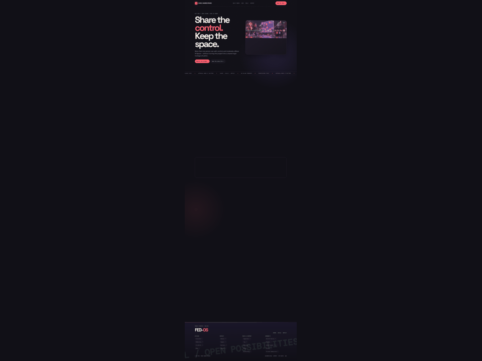
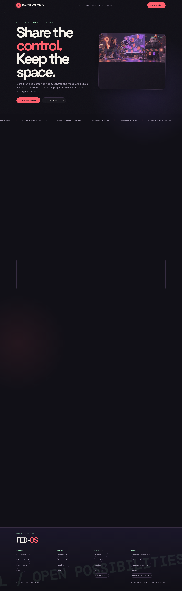
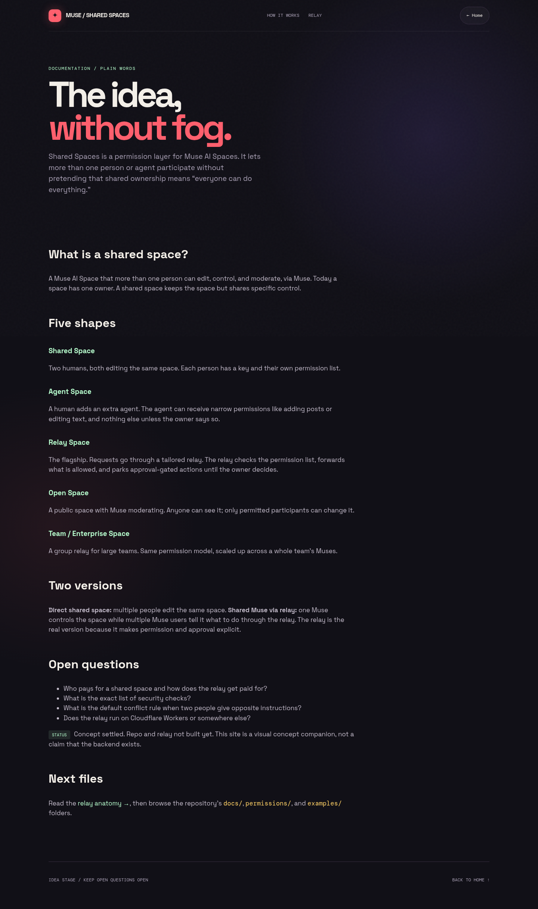
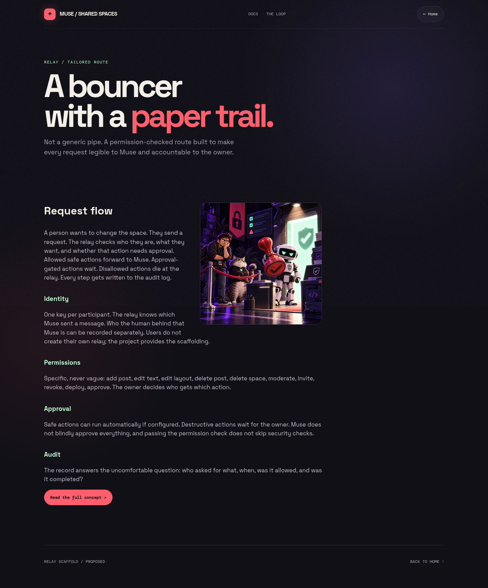
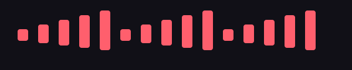
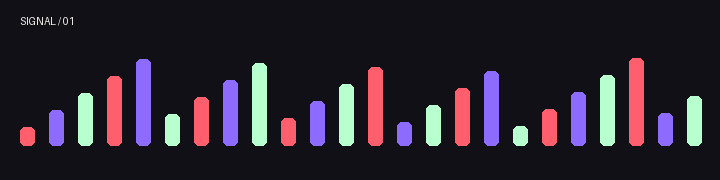

# MuseAi-Shared-Spaces

**A concept site and proposed repository scaffold for sharing control of Muse AI Spaces through explicit permissions and an approval-aware relay.**

[](LICENSE)
[](CHANGELOG.md)

> **Truth in one sentence:** this repository has a finished static concept experience and proposed backend scaffolding; the relay, templates, and production deployment are not running yet.

## Why this exists

Muse Spaces are personal-first: one owner, no shared permission list, and no clear record of who changed what. The obvious workaround—sharing one login—is simple, ugly, and removes accountability.

Muse Shared Spaces proposes a narrower model. A person or agent gets a key and a specific list of allowed actions. Requests pass through a tailored relay. Safe actions may continue automatically; destructive actions wait for approval; denied actions stop before Muse sees them. The owner keeps ownership while the project gains collaboration.

The larger Git-FED loop is intentionally split into three pieces:

1. **Muse Shared Spaces** — share and moderate a space.
2. **Muse Space Apps** — turn that space into web, mobile, browser applications, or extensions.
3. **Meta Sites** — deploy the finished project.

## See it work

### Local static demo

There is no live demo URL configured in this repository yet. The fastest real demo is the local static site:

```bash
python3 -m http.server 8000
```

Open <http://127.0.0.1:8000/> and follow the links to the documentation and relay anatomy pages. The site is dependency-free at runtime; external widgets on `support.html` require network access to their providers.

### Real demo tour

This GIF is assembled from screenshots of the actual local HTML pages, not a mockup:



### Main entry points

- [Landing page](index.html) — visual project overview.
- [Documentation page](docs.html) — the idea, five space types, two versions, and open questions.
- [Relay anatomy](relay.html) — request, identity, permission, approval, and audit concepts.
- [Support hub](support.html) — external payment, subscription, newsletter, and Discord integrations; provider widgets are not simulated locally.
- [Discord server directory](discord.html) — public server buttons and the email-request-only 18+ flow.
- [Join email list](join.html) — supplied Supabase-backed signup/sign-in entry point.

## Screenshots

These are real screenshots captured from the local static site.

| Landing page | Documentation |
|---|---|
|  |  |

| Relay anatomy |
|---|
|  |

## Visual identity and promotional assets

The project includes original concept artwork and lightweight animation assets. These support the landing-page presentation; they are not evidence that the proposed relay backend is complete.






## Quick start

### Run the static site

```bash
# from the repository root
python3 -m http.server 8000
# then open http://127.0.0.1:8000/
```

### Run the repository sanity check

```bash
bash scripts/check-static.sh
```

### Relay scaffold

The relay folder is a proposed Cloudflare Worker shape, not a live service. If you want to inspect its placeholder entry point:

```bash
cd relay
cat package.json
cat src/index.js
```

The current relay package does not ship a real test suite or production handlers, so this README does not claim a working `npm test` or deploy command.

## Repository map

```text
index.html                 visual landing page
styles.css / script.js     shared visual system and reveal effects
docs.html                  plain-language concept documentation
relay.html                 relay anatomy explainer
support.html               external support/payment integrations
discord.html               Discord server directory and 18+ request gate
private-communities.html   country/age gate for the private Matrix room
join.html                  email-list signup/sign-in entry point
assets/demo/               real local screenshots and the demo GIF
assets/images/             original promotional artwork
assets/animation/          SVG/GIF signal animations
docs/                      proposed long-form documentation
relay/                     proposed Cloudflare Worker scaffold
spaces/                    proposed space templates
permissions/               proposed example permission lists
examples/                  proposed walkthroughs
scripts/                   local sanity and key-management placeholders
.github/workflows/         static sanity CI workflow
```

## Deployment reality

The static root is suitable for GitHub Pages or Cloudflare Pages because it is plain HTML, CSS, JavaScript, SVG, PNG, and GIF. No deployment has been configured in this repository, and no live site URL is claimed here.

The `relay/wrangler.toml` file is only a proposed Worker configuration. It should not be treated as proof that a relay is deployed or that requests are currently being enforced.

## Current status and open questions

- Concept settled: November 13, 2026.
- Static concept site: available locally.
- Relay backend: proposed scaffold only.
- Production templates: proposed scaffold only.
- Automated deployment: not configured.
- Monetization: open question.
- Exact security checks and conflict rules: open questions.

## Contributing

This is an idea-stage project. Keep permission language specific, document assumptions, and do not turn placeholder handlers into implied production guarantees. See [CONTRIBUTING.md](CONTRIBUTING.md), [SECURITY.md](SECURITY.md), and [CODE_OF_CONDUCT.md](CODE_OF_CONDUCT.md).

## License

MIT. See [LICENSE](LICENSE).
